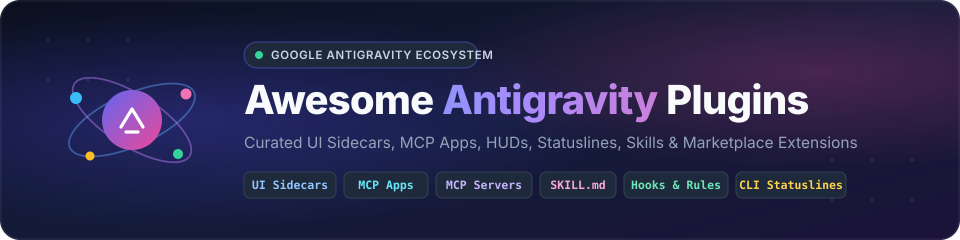

<div align="center">



<br />

[](https://awesome.re)
[](#contents)
[](./CONTRIBUTING.md)
[](./LICENSE)

**English** · [简体中文](./README_CN.md)

*A curated directory of plugins, Auxiliary Pane UI sidecars, macOS/Desktop HUDs, CLI statuslines, MCP bundles, and official Marketplace extensions for **Google Antigravity (`agy` & Antigravity 2.0 Desktop/IDE)**.*

</div>

---

> [!NOTE]
> **What is an Antigravity Plugin?**
> In Google Antigravity, a **plugin** (`plugin.json`) is a single namespaced bundle that ships, enables, and disables together—combining **UI Sidecars** (`sidecars/`), **Skills** (`skills/<name>/SKILL.md`), **MCP Servers** (`mcp_config.json`), **Lifecycle Hooks** (`hooks.json`), **Rules** (`rules/AGENTS.md`), and **Subagents** (`agents/`).

## Contents

- [Desktop UI, Auxiliary Pane & HUDs](#desktop-ui-auxiliary-pane--huds)
- [Telemetry, Context Window & Statuslines](#telemetry-context-window--statuslines)
- [Performance, Workflow & Swarm Orchestration](#performance-workflow--swarm-orchestration)
- [Browser, Computer Use & Creative Automation](#browser-computer-use--creative-automation)
- [Cross-Agent Bridges & ACP Ecosystem](#cross-agent-bridges--acp-ecosystem)
- [Official & Partner Marketplace Catalog](#official--partner-marketplace-catalog)
  - [Google Ecosystem & Cloud](#google-ecosystem--cloud)
  - [Databases, Cloud & Deployment](#databases-cloud--deployment)
  - [Observability, Security, Testing & Auth](#observability-security-testing--auth)
  - [Design, Product & Business](#design-product--business)
- [Skill Suites & Plugin Authoring Toolkits](#skill-suites--plugin-authoring-toolkits)
- [Environment & Multi-Account Managers](#environment--multi-account-managers)
- [Localization, Themes & Accessibility](#localization-themes--accessibility)
- [Quick Install & Plugin Anatomy](#quick-install--plugin-anatomy)
- [Contributing](#contributing)

---

## Desktop UI, Auxiliary Pane & HUDs

*Native `UI Sidecar` (`SIDECAR_UI_ENTRYPOINT_AUX_PANE`) workbenches, macOS floating HUDs, and interactive desktop panels built for Antigravity 2.0.*

- **[AGY Floating HUD](https://github.com/biTQ-m/agy-floating-hud)** — Always-on-top macOS Dynamic Capsule (`NSPanel`) HUD for Antigravity 2.0 Desktop: tracks multi-session progress in real time via read-only SQLite WAL + Lifecycle Hooks, shows live tool actions and `task.md` checklist percentages, jumps to any session in `<5ms`, and plays completion glow/chime alerts. `macOS` `Swift + Sidecar + Hooks`
- **[Postman Studio (`agy-postman`)](https://github.com/biTQ-m/agy-postman)** — Zero-dependency visual HTTP, REST & SSE API workbench inside Antigravity's Auxiliary Pane featuring a zero-CORS local Node proxy, DNS/TCP/TLS/TTFB timing waterfall, live `transcript.jsonl` cURL/endpoint sniffer, Postman Collection v2.1 import/export, mini concurrency load tester, and two-way AI Skill integration. `Aux Pane Sidecar + Skill`
- **[Voice Reader (`agy-voice-reader`)](https://github.com/biTQ-m/agy-voice-reader)** — Immersive English pronunciation & bilingual vocabulary workbench for Antigravity Desktop (macOS): double-tap `⌥` or Force Click any word/sentence to speak via a ~120ms hot dictionary socket + Microsoft Edge Neural HD voices, auto-injects vocabulary & code-switching rules (`rules/AGENTS.md`), and extracts clickable word cards in the side panel. `macOS` `Aux Pane Sidecar + Rules + Skill`
- **[Voice Wake (`voice-wake`)](https://github.com/rmqg/antigravity-voice-wake)** — Offline macOS wake-word and global hotkey launcher for Google Antigravity: detects English phrases (`sherpa-onnx` Zipformer) or recorded voice samples (`EfficientWord-Net` INT8 ONNX) locally while protecting Bluetooth audio via built-in mic routing, opens a target project/model chat, triggers native dictation with Silero VAD auto-submit, and ships a bilingual 3-tab Auxiliary Pane UI. `macOS` `Swift + Aux Pane Sidecar + Skill`
- **[AGY Powertools](https://github.com/WhiteBr1ck/agy-powertools)** — Native Antigravity 2.0 interface enhancement plugin featuring compact Codex-inspired typography, structured phase reporting, context & cache monitoring, session branching, and local usage views.
- **[Antigravity Sidecar Studio](https://github.com/burnerous/antigravity-sidecar-studio)** — Three-in-one Auxiliary Pane workspace combining a project file tree, offline high-fidelity Word/Excel/PPT/PDF preview & editing, text-selection quoting to AI, and a read-only trajectory viewer.
- **[Antigravity Doc Preview](https://github.com/Cl-Ask47/antigravity-doc-preview)** — Preview PDF, Word, PowerPoint, and Excel documents directly inside the Antigravity sidecar and inline chat.
- **[Antigravity Pulse](https://github.com/yangyu2004/antigravity-pulse)** — Inline chat step cards, lifecycle stall detector, and real-time token throughput & quota dashboard.
- **[Antigravity Inline Editor](https://github.com/mustafaakben/antigravity-inline-editor)** — Unofficial inline Edits tab for Antigravity Desktop with autosave, find & replace, comment, and quote actions.

---

## Telemetry, Context Window & Statuslines

*Local-first observability tools for tracking token throughput (`tok/s`), context compaction budgets, prompt cache efficiency, and `agy` CLI statuslines.*

- **[AGY Statusline & Desktop Status](https://github.com/2fa0/agy-statusline)** — Zero-dependency, 100% local read-only telemetry suite pairing a fast Zig CLI `statusLine` with an `AGY Desktop Status` right-pane tab for output speed (`tok/s`), turn/session duration, context usage, and prompt cache hit rate.
- **[AGY Capsule](https://github.com/Lumidarin/agy-capsule)** — Displays live context usage, model quotas, token breakdowns, and generation metrics directly inside the Antigravity composer.
- **[Antigravity Context Mode](https://github.com/Domush/antigravity-plugin-context-mode)** — Local-first context protection plugin that cuts context bloat by 90%+ by preventing verbose terminal logs and multi-megabyte files from flooding conversation history.
- **[AGY Context Dashboard](https://github.com/wycocoyu/agy-context-dashboard)** — Real-time context window, token usage, cache hit rate, and quota dashboard for Antigravity.
- **[AGY Powerline](https://github.com/wassim-azi/agy-powerline)** — Zero-dependency `agy` CLI statusline with Gemini & Claude quota pacing, context progress bars, Git widgets, 22 themes, and interactive TUI and [browser](https://agy-powerline.com/configure/) configurators.
- **[AGY HUD](https://github.com/franksde/agy-hud)** — Lightweight Antigravity CLI status plugin surfacing context window consumption, quota status, active model, and agent state.
- **[Antigravity Desktop Context](https://github.com/dimitr-io/antigravity-desktop-context)** — Live `/context` side panel inspector for the Antigravity 2.0 desktop app.
- **[Antigravity Dashboard](https://github.com/ShZbz/antigravity-dashboard)** — Real-time token telemetry, quota tracker, and Rust-accelerated usage ledger across Antigravity Desktop, IDE, and CLI.
- **[AGY Context](https://github.com/ahmetdotsh/agy-context)** — Native sidecar plugin to inspect live context window usage, prompt cache efficiency, and per-turn token breakdowns.
- **[AGY Usage](https://github.com/ahmetdotsh/agy-usage)** — Native sidecar plugin for token usage analytics, API-equivalent cost estimation, and prompt cache savings.
- **[AGY Lens](https://github.com/xukp20/agy-lens)** — Local-first Desktop telemetry sidecar featuring a prompt cache observatory, long-context cost analytics, and a daily activity heatmap.
- **[Antigravity Status Monitor](https://github.com/rimenine/antigravity-status-monitor)** — Real-time Sidecar tracking agent phases, Lifecycle Hooks, and upstream reachability to distinguish active work from silent hangs.
- **[ag-vario](https://github.com/Staaaying/ag-vario)** — Zero-dependency, read-only macOS HUD for Antigravity 2.0 Desktop showing per-pane composer cards (session tokens, 5-category context breakdown, subagents across 2/3/4+ split panes) alongside titlebar `5h`/`7d` quota rings and a 30-day usage heatmap, with verified backup and lossless restore. `macOS` `Desktop HUD`

---

## Performance, Workflow & Swarm Orchestration

*Plugins that accelerate turn latency, organize conversation workflows, streamline code reviews, or coordinate multi-agent engineering loops.*

- **[AGY Fast](https://github.com/INK-Q/agy-fast)** — Non-invasive MCP accelerator plugin for Antigravity (CLI/Desktop/IDE) designed to reduce redundant LLM turns, token consumption, and upload payloads while preserving native diffs.
- **[agy-memory](https://github.com/maxLWS/agy-memory)** — Local, zero-dependency cross-conversation memory plugin for Antigravity (CLI/Desktop/IDE): injects a read-only `SessionStart` snapshot, searches transcripts (with `transcript_full.jsonl` hydration), artifacts, and Swarm boards, traces verified file edits (`file_history`) and command failures (`error_history`), stores editable Markdown notes with revision CAS, and optionally reads local Codex/Claude sessions. `MCP + Hooks + Rules + CLI`
- **[AGY Dart](https://github.com/zou172866/agy-dart)** — All-in-one plugin uniting batched latency acceleration with local SQLite FTS5 context-window protection and a live Sidecar dashboard.
- **[AGY Fast IO](https://github.com/oil-oil/agy-fast-io)** — Lightweight local rule plugin that trims unnecessary agent round-trips and redundant confirmation pauses.
- **[Antigravity Conversation Renamer MCP](https://github.com/falconchen/antigravity-conversation-renamer-mcp)** — Lightweight Node.js (`node:sqlite`) Stdio MCP server paired with a `/rename` Skill and optional topic-drift Rule: dynamically renames active or historical conversation titles cleanly on disk across `.pbtxt` annotations, SQLite FTS5 indexes, and Protobuf caches without Accessibility permissions or client restarts. `MCP + Skill + Rules`
- **[AGYStack](https://github.com/jtaroreh/agystack)** — Closed-loop engineering workflow and multi-agent swarm orchestration plugin for Google Antigravity.
- **[Mission Control for Antigravity](https://github.com/todd866/antigravity-mission-control)** — Live pictorial Mission Control cockpit (MCP App), turn-aware AI briefings, cross-Mac relay (`agy-status` / `agy-relay`), and adaptive Flash/Carbon/Neon AI Commander for coordinating Antigravity agents. `MCP App + CLI`
- **[Multigravity](https://github.com/GHSaiMo/antigravity-mobile)** — Open-source (MIT) native iOS (App Store), Android, and Web PWA mobile companion with a local Go gateway (`mgy`) for Antigravity IDE/CLI: real-time chat & `/swarm` Hive monitoring, Dynamic Island live steps, APNs lock-screen command approvals, 5h/7d quota widgets, 20-week token/cache auditing, and zero-knowledge E2EE (`mgy-e2ee-v1`). `iOS / Android / PWA` `Local Go Gateway`
- **[CodeRabbit Antigravity Plugin](https://github.com/coderabbitai/antigravity-plugin)** — Official CodeRabbit plugin bringing automated AI code reviews and guarded PR autofix workflows into Antigravity.
- **[AGY GCP Companion](https://github.com/ericsk/agy-gcp-companion)** — Inspect Google Cloud projects, billing accounts, budget thresholds, and BigQuery month-to-date spend inside Antigravity.

---

## Browser, Computer Use & Creative Automation

*Plugins extending Antigravity across browser workflows, native OS GUI automation, and robotics.*

- **[GDM Robotics Plugin](https://github.com/google-deepmind/robotics-antigravity-plugin)** — Official Google DeepMind Robotics skills for 3D perception, collision-free motion planning, visual servoing, MuJoCo simulation, and sim2real robot bring-up.
- **[Antigravity Flow](https://github.com/WeZZard/antigravity-flow)** — Antigravity plugin for Google Flow creative generation powered by Antigravity's built-in browser subagent.
- **[Computer Use AGY](https://github.com/Jayanyixing/computer-use-agy)** — Open-source (MIT) macOS Computer Use MCP server and Antigravity plugin for desktop GUI interaction.
- **[Antigravity Cua Driver](https://github.com/WeZZard/antigravity-cua-driver)** — Background native GUI automation plugin across macOS, Windows, and Linux powered by Cua Driver.
- **[Firecrawl Antigravity Plugin](https://github.com/firecrawl/firecrawl-antigravity-plugin)** — Official Firecrawl plugin for clean web scraping, full-site crawling, and LLM-ready Markdown extraction.
- **[ultrafast](https://github.com/ultrafastmov/ultrafast)** — Open-source (MIT/Apache-2.0) GPU video engine with an `agy` plugin: the agent writes a video as a JSON document, then checks it, looks at contact sheets and exact frames, reviews it for unreadable, clipped or overlapping text, and exports MP4, ProRes, WebM or GIF through 20 local MCP tools. Linux (Vulkan) and macOS (Metal). `MCP + Skill`

---

## Cross-Agent Bridges & ACP Ecosystem

*Agent Client Protocol (ACP) servers and multi-agent bridges connecting `agy` with Claude Code, Codex, Cursor, and external editors.*

- **[AGY Staff](https://github.com/keli-wen/agy-staff)** — Delegate fast Gemini coding, research, and review subtasks to `agy` CLI from Claude Code, OpenAI Codex, and other coding harnesses.
- **[Antigravity ACP](https://github.com/shubzkothekar/antigravity-acp)** — Bun-powered Agent Client Protocol (ACP) server allowing ACP-compatible editors to drive `agy` with live streaming and history replay.
- **[Antigravity Plugin for Claude Code (`simplybychris`)](https://github.com/simplybychris/antigravity-plugin-cc)** — Invoke `agy` directly inside Claude Code to delegate tasks, run quick prompts, or request cross-model code reviews.
- **[AGY Bridge](https://github.com/sshahzaiib/agy-bridge)** — MCP bridge enabling Claude Code to offload heavy tasks to `agy` with model fallback routing, session continuity, and output truncation.
- **[AGY MCP](https://github.com/Boulea7/agy-mcp)** — Exposes `agy` as a 10-tool MCP server with worktree-isolated execution and long-task supervision for Cursor, Codex, or any MCP client.
- **[NotebookLM via Antigravity](https://github.com/MarcosNahuel/antigravity-plugin-cc)** — Turns local document folders into per-doc summaries, relevance indexes, cited syntheses, audio/video transcripts, and HTML research reports via `agy`.
- **[agy-remote-wecom](https://github.com/lukeinx/agy-remote-wecom)** — Control local Antigravity (`agy`) terminal sessions and background `agy acp` sessions from WeCom on your phone over an outbound WebSocket long connection (no public server), with session resume, attachments, model/mode switching, tool-approval cards, and artifact retrieval (macOS, Chinese UI & commands).

---

## Official & Partner Marketplace Catalog

*First-party and verified partner plugins available directly inside the **Antigravity Agent Marketplace** (`Customizations → Plugins`). Reference them by their `Catalog ID`.*

### Google Ecosystem & Cloud

| Plugin | Catalog ID | Highlights |
| :--- | :--- | :--- |
| **Google Antigravity SDK** | `antigravity-plugins-official/plugin/google-antigravity-sdk` | Official skills and patterns for building AI agents with the Antigravity Python SDK. |
| **Google Cloud Developer** | `antigravity-plugins-official/plugin/google-cloud-developer` | GCP onboarding, credential selection, `gcloud` safety checks, and Developer Knowledge MCP. |
| **Google Developer Knowledge** | `antigravity-plugins-official/plugin/google-developer-knowledge` | Grounded search across official Cloud, Gemini, Android, Firebase, Flutter, and Web docs. |
| **Firebase** | `antigravity-plugins-official/plugin/firebase` | Prototype, build, and operate modern apps with Firebase backend, Auth, and AI services. |
| **Dart & Flutter** | `antigravity-plugins-official/plugin/flutter` | Official Flutter/Dart skills, rules, custom agents, and the Dart MCP server. |
| **Android CLI** | `antigravity-plugins-official/plugin/android-cli-plugin` | Core CLI workflows and architectural guidance for Android engineering. |
| **Google Workspace Suite** | `antigravity-plugins-official/plugin/gdocs` *(+ `gsheets`, `gslides`, `gdrive`, `gcalendar`)* | Read, draft, format, schedule, and manage Google Docs, Sheets, Slides, Drive, and Calendar. |
| **Data Agent Kit** | `antigravity-plugins-official/plugin/data-agent-kit-plugin` | Specialized skills for data engineers and database architects on Google Cloud. |
| **Google Maps Platform** | `antigravity-plugins-official/plugin/google_maps_platform` | Integration skills and tools for Google Maps Platform APIs. |
| **Scientific & Robotics** | `antigravity-plugins-official/plugin/robotics` *(+ `genomics`, `structural-biology`)* | DeepMind Robotics, AlphaGenome genetics analysis, and AlphaFold protein structure exploration. |

### Databases, Cloud & Deployment

| Plugin | Catalog ID | Highlights |
| :--- | :--- | :--- |
| **Supabase** | `antigravity-plugins-partners/plugin/supabase` | Official Supabase MCP & skills for Postgres schema design, RLS, Auth, Storage, and Edge Functions. |
| **MongoDB Atlas** | `antigravity-plugins-partners/plugin/mongodb-atlas` | Hosted Atlas MCP server + collection management, aggregation, and query optimization skills. |
| **Neo4j** | `antigravity-plugins-partners/plugin/neo4j` | Cypher query authoring, graph data modeling, GraphRAG pipelines, and Aura administration. |
| **Databricks** | `antigravity-plugins-partners/plugin/databricks` | Lakebase, Model Serving, Lakeflow Jobs, Spark Declarative Pipelines, and Asset Bundles (DABs). |
| **Vercel** | `antigravity-plugins-partners/plugin/vercel-plugin` | Next.js, AI SDK, and cloud deployment skills paired with the official Vercel MCP server. |
| **Cloudflare** | `antigravity-plugins-partners/plugin/cloudflare` | Build and deploy on Cloudflare Workers, KV/R2/D1 storage, and AI Gateway via Cloudflare MCP. |
| **Netlify** | `antigravity-plugins-partners/plugin/netlify` | Serverless & edge functions, blobs, database, image CDN, and the Netlify MCP server. |
| **Railway** | `antigravity-plugins-partners/plugin/railway` | Deploy, configure, and troubleshoot apps, databases, and infrastructure via Railway MCP. |

### Observability, Security, Testing & Auth

| Plugin | Catalog ID | Highlights |
| :--- | :--- | :--- |
| **Sentry** | `antigravity-plugins-partners/plugin/sentry` | Triage production exceptions, inspect stack traces, and configure alerts & releases with live context. |
| **Grafana Cloud** | `antigravity-plugins-partners/plugin/grafana-cloud-mcp` | Query Prometheus metrics, Loki logs, Tempo traces, profiles, and incidents via hosted MCP. |
| **SonarQube** | `antigravity-plugins-partners/plugin/sonarqube` | Catch bugs, security vulnerabilities, and leaked secrets across 7,500+ rules inside the agent loop. |
| **Browserbase** | `antigravity-plugins-partners/plugin/browse` | Local and cloud headless browsers for navigation, interaction, screenshots, and data extraction. |
| **Harness** | `antigravity-plugins-partners/plugin/harness-antigravity` | Build and debug CI/CD pipelines, manage deployments, and investigate security findings. |
| **TestMu AI** | `antigravity-plugins-partners/plugin/testmu-ai` | Cloud test triage plus Kane CLI for browser/mobile automation and Rook CLI for agent testing. |
| **Auth0** | `antigravity-plugins-partners/plugin/auth0` | Add login, MFA, SSO, Organizations, RBAC, and custom domains to any application. |
| **Clerk** | `antigravity-plugins-partners/plugin/clerk` | User management, organizations, billing, webhooks, and testing skills + Clerk MCP server. |

### Design, Product & Business

| Plugin | Catalog ID | Highlights |
| :--- | :--- | :--- |
| **Figma** | `antigravity-plugins-partners/plugin/figma` | Turn Figma designs into production code, map components with Code Connect, and edit Figma files. |
| **Canva** | `antigravity-plugins-partners/plugin/canva` | Create, resize, review, and brand-check designs through the Canva MCP server. |
| **Mobbin** | `antigravity-plugins-partners/plugin/mobbin` | Search 600,000+ real-world mobile and web app UI flows directly from your agent. |
| **Linear** | `antigravity-plugins-partners/plugin/linear` ([Repo](https://github.com/linear/antigravity-plugin)) | Manage issues, cycles, specs, and engineering roadmaps in Linear. |
| **Notion** | `antigravity-plugins-partners/plugin/notion` | Search Notion workspaces, draft specs, summarize meetings, and maintain project trackers. |
| **Atlassian Teamwork Graph** | `antigravity-plugins-partners/plugin/atlassian-twg-cli` | Agent-first CLI unifying Jira issues, Confluence pages, and Bitbucket PRs. |
| **Stripe** | `antigravity-plugins-partners/plugin/stripe` | Manage products, prices, payment links, subscriptions, invoices, and Stripe docs via MCP. |

---

## Skill Suites & Plugin Authoring Toolkits

*SDKs for scaffolding new Antigravity plugins/sidecars and standalone `SKILL.md` collections that can be bundled into plugins.*

- **[Antigravity Sidecar Kit](https://github.com/arthurcavallari/antigravity-sidecar-kit)** — Zero-dependency SDK and CLI scaffolder for Antigravity Auxiliary Pane sidecars (Connect RPC client, host theme & Tailwind proxy, config store, and installer).
- **[Antigravity Skills (`rmyndharis`)](https://github.com/rmyndharis/antigravity-skills)** — Large community-curated library of Agent Skills for Google Antigravity across full-stack engineering domains.
- **[Sample Google Antigravity Skills (`rominirani`)](https://github.com/rominirani/antigravity-skills)** — Clean reference examples for authoring modular `SKILL.md` bundles in Antigravity.
- **[Antigravity Skills Engine](https://github.com/buiquangvu235/antigravity-skills-engine)** — Structured multi-track skill collection for autonomous software engineering workflows.
- **[Antigravity n8n Skills](https://github.com/WilkoMarketing/antigravity-n8n-skills)** — Specialized Antigravity skills for n8n workflow design, node configuration, and schema validation.
- **[Spec-Kit Antigravity Skills](https://github.com/compnew2006/Spec-Kit-Antigravity-Skills)** — Spec-Driven Development skill system covering requirements, architecture, implementation, and verification.
- **[Antigravity Skills Chronicle](https://github.com/Zaious/Antigravity-Skills-Chronicle)** — Visual dashboard extension for browsing and managing agent skills, workflows, and rules.

---

## Environment & Multi-Account Managers

*Cross-platform CLI/TUI utilities for managing isolated Antigravity account profiles, quota inspection, and local client environments.*

- **[agy-manager (`eligibility-antigravity-patcher`)](https://github.com/QNIX-Dev/eligibility-antigravity-patcher/blob/main/README.en.md)** ([Repo](https://github.com/QNIX-Dev/eligibility-antigravity-patcher)) — Lightweight cross-platform environment manager (`Windows` / `Linux` / `macOS`, `x64` & `arm64`) with both an interactive TUI and a zero-dependency Python CLI: supports isolated multi-account profiles, live 5-hour/weekly quota monitoring, and reversible client-side eligibility patching with automatic backup & signature restore.
- **[AGY Switch](https://github.com/anglee0323/agy-switch)** — Manage Antigravity accounts, model quotas, and local usage across macOS, Windows, and Linux through desktop and CLI interfaces.
- **[AGY Auth](https://github.com/fikrilal/agy-auth)** — Multi-account switcher for Google Antigravity CLI and Desktop (`agy`).
- **[AGY CLI Manager](https://github.com/zcop/agy-cli-manager)** — Multi-account manager for Antigravity CLI featuring quota-aware failover, switching policies, and automation hooks.
- **[agy-swap](https://agy-swap.aklkbqx.com/)** ([Repo](https://github.com/aklkbqx/agy-swap)) — Cross-platform Go TUI and CLI (`macOS` / `Linux` / `Windows`) for switching Google Antigravity CLI and IDE/Desktop accounts with live per-model quota inspection, session guards against background token overwrites, and automatic local backups before writes. Stores credentials locally (`0600` `vault.json` or OS keychain via `AGY_SWAP_VAULT=keychain`) with no usage telemetry and an optional cached daily version check. `TUI + CLI`

---

## Localization, Themes & Accessibility

*Community language packs, color themes, and typography engines for Antigravity Desktop.*

- **[Antigravity zh-CN (`MIMICTE`)](https://github.com/MIMICTE/Antigravity-zh-CN)** — Simplified Chinese localization patch for Antigravity Desktop.
- **[Antigravity Desktop CN (`Silas-02`)](https://github.com/Silas-02/antigravity-desktop-cn)** — Cross-platform (macOS / Windows / Linux) Simplified Chinese localization engine with one-click install and clean restore.
- **[Antigravity Themes](https://github.com/materialwebunofficial/antigravity-themes)** — Custom UI color themes for the Antigravity Desktop app.
- **[Antigravity Tradução PT-BR](https://github.com/Emertels/Antigravity-Traducao-PTBR)** — Portable Brazilian Portuguese localization package for Antigravity Desktop.
- **[RZ Antigravity RTL](https://github.com/rezasalimi01/rz-antigravity-rtl)** — High-performance Persian & Arabic RTL typography engine with offline fonts and strict Monaco editor isolation.

---

## Quick Install & Plugin Anatomy

### Installing Community Plugins

Most open-source Antigravity plugins ship an `install.sh` script (creating a symlink or copy inside `~/.gemini/config/plugins/<plugin-dir>`):

```bash
git clone https://github.com/<author>/<plugin-repo>.git
cd <plugin-repo>
chmod +x ./install.sh && ./install.sh
```

Once installed, manage or toggle any plugin live in **Customizations → Plugins** inside Antigravity Desktop (no restart needed for skills, rules, or MCP bundles; reopen or `+` add Auxiliary Pane tabs for UI Sidecars).

### Standard Plugin Directory Layout

```text
~/.gemini/config/plugins/<plugin-name>/
├── plugin.json                 # Required manifest (name, description, logo, suggestedPrompts)
├── README.md                   # Human-facing documentation
├── assets/logo.svg             # Square SVG/PNG icon (128x128+, ~10% margin)
├── sidecars/<id>/sidecar.json  # Optional Auxiliary Pane UI sidecar service
├── skills/<skill>/SKILL.md     # Optional on-demand agent skills
├── agents/<agent>.md           # Optional specialized subagents
├── rules/AGENTS.md             # Optional always-on prompt rules while plugin is enabled
├── hooks.json                  # Optional PreInvocation / PostToolUse / Stop lifecycle hooks
└── mcp_config.json             # Optional bundled MCP server definitions
```

---

## Contributing

Contributions, new plugins, and category improvements are warmly welcome! Please read [CONTRIBUTING.md](./CONTRIBUTING.md) or [open a Plugin Submission issue](../../issues/new?template=submit-plugin.yml) before submitting a pull request.

> **Disclaimer & Security Policy**: Community utilities that modify local client bundles (such as localization patches or environment patchers) are unofficial and used at your own discretion—always back up your installation first. Repositories containing malware, credential/token harvesters, or deceptive telemetry will never be accepted.

## License

[](https://creativecommons.org/publicdomain/zero/1.0/)

To the extent possible under law, [biTQ-m](https://github.com/biTQ-m) has waived all copyright and related or neighboring rights to this work under [CC0 1.0 Universal](./LICENSE).
