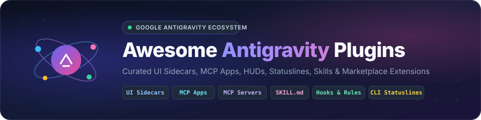

<div align="center">



<br />

[](https://awesome.re)
[](#目录导航)
[](./.github/workflows/validate.yml)
[](./CONTRIBUTING.md)
[](./LICENSE)

[English](./README.md) · **简体中文**

*精选收录面向 **Google Antigravity（`agy` CLI & Antigravity 2.0 Desktop / IDE）** 的开源插件、右侧辅助面板（Aux Pane UI Sidecar）、交互式 MCP App、桌面灵动岛悬浮窗（HUD）、终端状态栏、多智能体工程流与官方应用市场扩展。*

</div>

---

> [!NOTE]
> **什么是 Antigravity Plugin？**
> 在 Google Antigravity 中，**插件（`plugin.json`）** 是可整体安装、启用与停用的命名空间扩展包，内部可自由组合 **UI Sidecar 侧边栏面板**（`sidecars/`）、**交互式 MCP App**（基于 `ui://` 资源在对话内联、右侧辅助栏 `aux_pane` 或左侧全屏栏 `global` 渲染）、**Skills 技能**（`skills/<name>/SKILL.md`）、**MCP 服务**（`mcp_config.json`）、**生命周期钩子**（`hooks.json`）、**常驻提示词规则**（`rules/AGENTS.md`）以及 **子代理**（`agents/`）。

## 目录导航

- [桌面端 UI 面板、辅助栏与悬浮窗 (HUD)](#桌面端-ui-面板辅助栏与悬浮窗-hud)
- [遥测监控、上下文窗口与 CLI 状态栏](#遥测监控上下文窗口与-cli-状态栏)
- [性能加速、跨会话记忆与多智能体编排](#性能加速跨会话记忆与多智能体编排)
- [浏览器自动化、Computer Use 与创意工作流](#浏览器自动化computer-use-与创意工作流)
- [跨智能体桥接、ACP 协议与远程移动端](#跨智能体桥接acp-协议与远程移动端)
- [官方与合作伙伴 Marketplace 精选目录](#官方与合作伙伴-marketplace-精选目录)
  - [Google 官方生态、云服务与科研](#google-官方生态云服务与科研)
  - [数据库、云平台与应用部署](#数据库云平台与应用部署)
  - [可观测性、安全扫描、代码审查与测试](#可观测性安全扫描代码审查与测试)
  - [设计创意、效率协作、实时搜索与商业应用](#设计创意效率协作实时搜索与商业应用)
- [Skill 技能合集与插件开发脚手架](#skill-技能合集与插件开发脚手架)
- [环境配置与多账号管理工具](#环境配置与多账号管理工具)
- [界面汉化、主题美化与无障碍排版](#界面汉化主题美化与无障碍排版)
- [快速安装指南与标准插件结构](#快速安装指南与标准插件结构)
- [贡献与收录规范](#贡献与收录规范)

---

## 桌面端 UI 面板、辅助栏与悬浮窗 (HUD)

*专为 Antigravity 2.0 桌面端打造的原生 `UI Sidecar`（`AUX_PANE` 与 `SIDEBAR`）工作台、交互式 `MCP App`、macOS 刘海灵动岛悬浮窗、语音唤醒与桌面交互增强套件。*

### 原生灵动岛 HUD、语音交互与项目启动台

- **[AGY Floating HUD](https://github.com/biTQ-m/agy-floating-hud)** — 专为 Antigravity 2.0 Desktop (macOS) 打造的全屏置顶**双灵动岛与多形态进度悬浮窗（`NSPanel`）**：自动适配 MacBook 原生刘海 G1 融黑（`e05`）与外接显示器悬浮黑曜胶囊（`island`，支持跨屏拖拽摘下与磁吸归位），内置 12 款「进行中 × 已完成」双态微缩信标（`E01`–`E10`）、120Hz 单壳体液态变形物理引擎（`M1`–`M4`）、3 大展开风格 × 5 款液态玻璃主题、SQLite WAL 毫秒级多会话监控、`<5ms` 点击直达对应会话标签页及右侧可视化控制中心与 `floating-hud` Skill。`macOS` `Swift + Sidecar + Skill + Hooks`
- **[Project Pinboard (`agy-pin-projects`)](https://github.com/biTQ-m/agy-pin-projects)** — Antigravity 2.0 **置顶项目启动台与四合一自定义图标工坊**（同时支持右侧辅助栏 `AUX_PANE` 与左侧导航栏 `SIDEBAR`）：只读聚合本地会话库工作区或手动添加目录，支持可视化折叠项目分组、跨组拖拽排序与列表/宫格双视图，内置 32 款开发矢量图标、Emoji/字母徽章、图片粘贴上传与仓库 Logo 自动嗅探，点击卡片 `<5ms` 切入活跃会话并与 `pin-projects` Skill 双向联动。`Aux Pane + Sidebar Sidecar + Skill`
- **[Voice Reader (`agy-voice-reader`)](https://github.com/biTQ-m/agy-voice-reader)** — Antigravity 2.0 极速发音与**沉浸式双语词汇工作台（macOS）**：选中文本连按两下 `⌥` 或深按触摸板（Force Click）即刻朗读，内置 ~120ms 真人词典热通道 + 微软 Edge 高清神经人声流式混读；启用插件即通过 `rules/AGENTS.md` 自动注入目标词汇量与中英混排提示词闭环，并在侧边栏自动提炼重点词汇卡片与双语场景例句抽屉。`macOS` `Aux Pane Sidecar + Rules + Skill`
- **[Voice Wake (`voice-wake`)](https://github.com/rmqg/antigravity-voice-wake)** — macOS 本地离线语音唤醒与全局快捷键插件：支持英文短语识别（`sherpa-onnx` Zipformer）与录制个人语音样本匹配（`EfficientWord-Net` INT8 ONNX），默认仅使用内置麦克风保护蓝牙音质，自动切项目/选模型并拉起听写、停顿自动发送，内置跟随系统语言的中英双语三标签侧边栏面板。`macOS` `Swift + Aux Pane Sidecar + Skill`
- **[Antigravity Pet](https://github.com/Wlaeg/antigravity-pet)** — 零第三方运行时依赖的 Windows & macOS 原生像素桌面宠物插件，内置 8 款动画角色（含 Android Bugdroid 与 Flutter Dash）、实时 Agent 状态气泡与点击互动。`Windows / macOS` `Desktop Companion`

### 右侧辅助面板工作台与交互式 MCP App

- **[Postman Studio (`agy-postman`)](https://github.com/biTQ-m/agy-postman)** — Antigravity 右侧辅助栏原生可视化 **HTTP / REST / SSE 接口调试工作台**：零第三方 npm 依赖，内置零 CORS 本地 Node 代理、DNS/TCP/TLS/TTFB 耗时瀑布图、`transcript.jsonl` 对话流接口/cURL 自动嗅探、Postman Collection v2.1 导入导出、迷你并发压测与 AI Skill 双向互通。`Aux Pane Sidecar + Skill`
- **[Antigravity Sidecar Studio](https://github.com/burnerous/antigravity-sidecar-studio)** — 三合一侧边栏增强插件：集成工作区文件树、Word / Excel / PPT / PDF 离线高保真预览与编辑、划词引用联动 AI 及只读对话轨迹查看器。`Aux Pane Sidecar`
- **[Antigravity Doc Preview](https://github.com/Cl-Ask47/antigravity-doc-preview)** — 在 Antigravity 侧边栏与内联聊天中直接预览 PDF、Word、PowerPoint 和 Excel 文档。`Aux Pane Sidecar`
- **[Antigravity Inline Editor](https://github.com/mustafaakben/antigravity-inline-editor)** — 为 Antigravity 桌面端提供带自动保存、查找替换、批注与引用功能的内联编辑标签页。`Aux Pane Sidecar`
- **[Finder Explorer (`finder-explorer`)](https://github.com/jinxingtaire/finder-explorer)** — 零外部依赖的 macOS 原生 MCP App 插件：提供对话流内联文件卡片与右侧 `aux_pane` 目录浏览器，支持双击一键唤起 macOS 访达（`open -R`）高亮定位工作区或 `.gemini` 产物文件。`macOS` `MCP App + Rules`
- **[Antigravity Codex Monitor](https://github.com/Lyl101010/antigravity-codex-monitor)** — 面向本地官方 OpenAI Codex CLI（`codex exec`）的原生 MCP App 右侧栏实时监控与跨平台 `codex-worker` 派单套件：每 0.8s 纯本地只读轮询直播命令、语法高亮 Diff 与 Token/缓存命中率（零额外 LLM 消耗），内置 Git `--worktree` 隔离与无工作区自动落盘，零 `.asar`/CDP 侵入。`MCP App + Skill`

### 桌面界面套件与步骤交互增强

- **[Antigravity Max (`agy-max`)](https://github.com/wangbingnan136/agy-max)** — 面向 Antigravity 2.0 的综合工作台增强插件：集成可开关的 `agy-fast` 加速引擎、辅助栏文件树、类 Codex 搜索/Git/目标工程流、Prism 光学美化、上下文与额度看板及多账号切换。`Sidecar + MCP + Hooks`
- **[AGY Powertools](https://github.com/WhiteBr1ck/agy-powertools)** — Antigravity 2.0 原生界面增强套件：支持类 Codex 紧凑排版与阶段汇报、上下文与缓存监控、会话分支及本地用量面板。`Desktop UI`
- **[Obsidian Prism（黑曜棱镜）](https://github.com/RMvdesi/obsidian-prism)** — 面向 Google Antigravity 的原生光学界面套件：包含四套深浅配色、阻尼弹簧动效、会呼吸的 512K 上下文试管、推理等级滑块、像素伙伴与双对话模式。`Desktop UI`
- **[AGY Console（AGY 控制台 / `agy-monitor`）](https://github.com/aishadiaodeqishui/agy-monitor)** — 零依赖、零侵入的侧边栏控制台插件：集实时上下文与配额遥测、多 Agent 协作拓扑与类 Codex 历程追踪、输入框圆环 HUD / 整机壁纸美化以及可插拔 AI 桌宠工作室于一体。`Aux Pane Sidecar + HUD`
- **[AGY Claude Style](https://github.com/0DNANCY/agy-claude-style)** — 支持 Windows / macOS / Linux 的一体化界面重塑、多语言本地化、Token HUD 遥测增强与可交互像素小螃蟹桌宠（`Clawd`）插件。`Desktop UI + HUD`
- **[Antigravity Pulse](https://github.com/yangyu2004/antigravity-pulse)** — 提供 Claude 风格内联步骤卡片、生命周期卡死监测与实时 Token 吞吐量仪表盘。`Desktop UI + Telemetry`
- **[Anti-Claude](https://github.com/hongqi7/Anti-Claude)** — 通过零改包运行时 CDP 注入，将 Claude.app 风格的边做边说节奏、实时 `TodoWrite` 进度卡片与界面质感引入 Antigravity 桌面端。`Desktop UI`
- **[Antigravity Action Launchpad](https://github.com/404kidwiz/antigravity-action-launchpad)** — 零框架内联 MCP App（`ui://`）与规则插件，将重复输入 `"go"` 替换为单行键盘命令条（`1`–`3` 快捷键、`d` 展开详情）、定高零抖动悬停 `Why`/`What` 决策检视器、受 A2UI 启发的 `ChoicePicker` 选项芯片与内联短文本输入框、高危操作两步确认防护、Warm Light/Dark 原生主题适配，以及零 `npm install` 的一键粘贴 Slim/Full 双模式引导配置。`macOS / Linux / Windows` `MCP App + Rules`

---

## 遥测监控、上下文窗口与 CLI 状态栏

*100% 本地优先的观测插件、MCP App、系统托盘小组件与终端状态栏，用于实时追踪生成速度（`tok/s`）、上下文窗口预算、Prompt 缓存命中率与模型额度消耗。*

### 桌面端面板、MCP App 与悬浮监控

- **[AGY Vitals (`agy-vitals`)](https://github.com/2fa0/agy-vitals)** — 零外部依赖、纯本地只读的状态监控套件（原 `agy-statusline`）：同时集成 macOS 刘海 HUD、桌面端右侧常驻面板 `AGY Desktop Status` 与基于 Zig 构建的极速 CLI `statusLine`，实时展示输出速度（`tok/s`）、上下文曲线、Prompt 缓存命中率与配额重置倒计时。`macOS HUD + Sidecar + CLI statusLine`
- **[ag-vario](https://github.com/Staaaying/ag-vario)** — 面向 macOS Antigravity 2.0 桌面端的零依赖、纯只读观测 HUD：支持在 2/3/4 分屏各窗格输入栏独立展示会话 Token、5 类上下文构成与子代理状态，顶栏提供 `5h`/`7d` 额度圆环与 30 天用量热力图，自带原版备份与一键无损还原。`macOS` `Desktop HUD`
- **[Qufu Antigravity Monitor](https://github.com/QufuLabs/qufu-antigravity-monitor)** — 面向 Antigravity 2.0 桌面端的零 Token、零遥测本地模型配额监控插件：通过官方 `agy -p "/usage"` 实时追踪 Gemini 与 Claude/GPT 的 5 小时及每周剩余额度与每秒重置倒计时，包含跨平台 `aux_pane` + `global` 原生 MCP App 以及自动同步宿主主题配色的 Windows 置顶无边框迷你栏。`MCP App + Windows HUD`
- **[AGY Usage (`qiudai0627`)](https://github.com/qiudai0627/agy-usage)** — 零第三方依赖、100% 纯本地运行的实时额度与 Token 用量监控套件：集成 macOS 原生防刘海半透明悬浮胶囊（`Swift`）、Windows 任务栏迷你小组件、CLI `statusLine` 四格彩色进度条与 11 国语言网页监控台（支持浅色/通透/深色三套主题、Gemini 与 Claude/GPT 双池独立倒计时及一键脱敏战报卡）。`CLI statusLine + Desktop HUD`
- **[usage (`aqua5230`)](https://github.com/aqua5230/usage)** — 纯本地无遥测的 macOS 顶部菜单栏与 Windows 系统托盘小工具，将 Antigravity、Claude Code、Codex 与 Grok CLI 的 5 小时/周配额、消耗速率与 HTML 成本报告固定在屏幕角落（内置 16 套主题）。`macOS / Windows Tray`
- **[ContextRadar](https://github.com/eatingDream-antigravity-plugins/ContextRadar)** — 基于原生 Rust 构建的上下文遥测 MCP App，支持三路冷缓存归因分析、前缀安全切片蒸馏与受控 `/compact` 及 `target:new` 跨会话接力。`Rust MCP App`
- **[Antigravity Context Viewer](https://github.com/elviscjn-cjn/antigravity-context-viewer)** — 支持多语言的 Google Antigravity 2.x 上下文与用量看板，实时展示当前会话上下文占用、各模型剩余配额、生成速率以及 Desktop 与 CLI 历史 Token 消耗。`Sidecar`
- **[AGY Capsule](https://github.com/Lumidarin/agy-capsule)** — 直接在 Antigravity 输入框（Composer）内嵌展示上下文占用、模型配额、Token 细分与生成速率指标。`Composer HUD`
- **[Antigravity Context Window Monitor](https://github.com/AGI-is-going-to-arrive/Antigravity-Context-Window-Monitor)** — 实时监测会话上下文构成比例、双水位线预警（`Compaction` 与 `200k` 档位）以及主从角色路由计价归因。`Telemetry`
- **[Antigravity Usage & Speed Monitor](https://github.com/yuhuan-dev/antigravity-usage-monitor)** — 零外部 npm 依赖的本地监控工具，覆盖 Antigravity 2.0、IDE 与 CLI 的 Token 用量、上下文窗口、配额、生成速率（`TPS`）、首字耗时（`TTFT`）及子代理统计。`Sidecar + CLI`
- **[Antigravity Context Mode](https://github.com/Domush/antigravity-plugin-context-mode)** — 本地优先的上下文窗口保护插件，拦截超长终端输出、构建日志与大文件刷屏，可削减 90%+ 无效上下文膨胀。`Context Guard`
- **[AGY Context Dashboard](https://github.com/wycocoyu/agy-context-dashboard)** — 实时展示 Antigravity 上下文窗口、Token 消耗、缓存命中率与额度状态的仪表盘插件。`Sidecar`
- **[Antigravity Desktop Context](https://github.com/dimitr-io/antigravity-desktop-context)** — 面向 Antigravity 2.0 桌面端的实时 `/context` 侧边栏透视面板。`Aux Pane Sidecar`
- **[Antigravity Dashboard](https://github.com/ShZbz/antigravity-dashboard)** — 支持 Desktop、IDE 与 CLI 的实时 Token 遥测与 Rust 加速本地用量账本。`Rust + Sidecar`
- **[AGY Context (`ahmetdotsh`)](https://github.com/ahmetdotsh/agy-context)** — 原生 Sidecar 插件，用于查看实时上下文窗口构成、Prompt 缓存效率与单轮 Token 明细。`Aux Pane Sidecar`
- **[AGY Usage (`ahmetdotsh`)](https://github.com/ahmetdotsh/agy-usage)** — 原生 Sidecar 插件，统计历史 Token 用量、API 等价成本估算与缓存节省金额。`Aux Pane Sidecar`
- **[AGY Lens (`xukp20`)](https://github.com/xukp20/agy-lens)** — 本地只读桌面端遥测 Sidecar，内置 Prompt 缓存观测台、长上下文成本分析与日历热力图。`Aux Pane Sidecar`
- **[Antigravity Status Monitor](https://github.com/rimenine/antigravity-status-monitor)** — 实时追踪 Agent 执行阶段、Lifecycle Hooks 与上游连通性的 Sidecar，快速区分正常思考与静默卡顿。`Sidecar + Hooks`
- **[Antigravity Context Card](https://github.com/Shawn1565/antigravity-context-card)** — 零侵入、仿 Claude Desktop 风格的原生 MCP App 侧边栏、纯标准库 `agy` CLI `statusLine` 与**个性化一键智能建议回复**插件：本地 SQLite 静默学习个人表达风格，实时生成 1 主建议 + 2 备选（支持桌面端一键 `Send`、窗格隔离 `tmux` `Alt+y` 填入及零 Key 复用 `agy` 订阅 / BYOK / Ollama），并同步追踪真实 512K 自动压缩余量（`512K · 1M native`）、`Messages` / `Thinking` / `Tool I/O` 拆分与缓存命中率。`MCP App + Hooks + CLI statusLine`
- **[Context Lens](https://github.com/Bileneret/context-lens)** — 面向 Antigravity Desktop 的本地只读 MCP App（`ui://`）上下文窗口与提示缓存监控器：默认 `visibility: ["app"]` 零提示词开销，支持双上限显示（压缩预算 vs. 原生窗口）、基于 `node:sqlite` 的 `TopLevelTokenGroup` 精确拆分及 Gen 1/2/3 `transcript.jsonl` 回退、侧边栏 / 全局标签 / 可选聊天内卡片三种界面，以及一键 `updateModelContext()` 交接摘要。`MCP App (ui://)`

### Antigravity IDE 侧边栏与配额面板

- **[Antigravity Cockpit (`vscode-antigravity-cockpit`)](https://github.com/jlcodes99/vscode-antigravity-cockpit)** — 高人气 Antigravity IDE / VS Code 配额监控扩展，内置可视化 Webview 仪表盘、QuickPick 快捷状态栏与模型额度分组。`IDE Extension`
- **[Antigravity Panel](https://github.com/n2ns/antigravity-panel)** — 面向 Antigravity IDE 的侧边栏实时配额监控与会话缓存管理面板，追踪 Gemini / Claude / GPT 的 5 小时与周限额、消耗趋势与剩余续航预测。`IDE Extension`

### 终端 CLI 状态栏 (`agy`)

- **[AGY Powerline](https://github.com/wassim-azi/agy-powerline)** — 零依赖 `agy` CLI 状态栏，支持 Gemini 与 Claude 额度节奏提示、上下文进度条、Git 状态组件、22 套主题及终端 TUI 与[浏览器](https://agy-powerline.com/configure/)可视化配置器。`CLI statusLine`
- **[Antigravity CLI Statusline (`AndyAWD`)](https://github.com/AndyAWD/antigravity-cli-statusline)** — 跨平台多语言 `agy` CLI 状态栏与配套 Skill，集中呈现 API 配额、Token 用量、Git 分支状态与系统资源占用。`CLI statusLine + Skill`
- **[Antigravity CLI Statusline (`weby-homelab`)](https://github.com/weby-homelab/antigravity-cli-statusline)** — 响应式高信息密度的 Antigravity CLI（`agy`）终端状态栏插件。`CLI statusLine`
- **[Statusline HUD (`linbo0518`)](https://github.com/linbo0518/antigravity-hud)** — 基于纯 Bash + `jq` 构建的自适应多行终端 `statusLine` 与交互式 `/hud` 配置插件。`CLI statusLine + Skill`
- **[AGY HUD (`franksde`)](https://github.com/franksde/agy-hud)** — 轻量级 Antigravity CLI 状态插件，集中展示上下文用量、配额比例、当前模型信息与 Agent 运行态。`CLI statusLine`

---

## 性能加速、跨会话记忆与多智能体编排

*减少冗余轮次、持久化跨对话记忆、管理会话历史、执行规范驱动开发（SDD）与多 Agent 闭环协作插件。*

### 轮次加速、缓存保温、记忆检索与会话管理

- **[AGY Fast](https://github.com/INK-Q/agy-fast)** — 非侵入式 MCP 加速插件（支持 CLI / Desktop / IDE），在不破坏原生 UI 与 Diff 视图的前提下减少冗余工具轮次与 Token 开销。`MCP + Rules`
- **[AGY Dart](https://github.com/zou172866/Antigravity-agy-dart)** — 零依赖综合增强插件：融合 KV-Cache 自动保温、本地 SQLite FTS5 上下文配额保护、崩溃会话恢复、批量工具加速与实时 Sidecar 仪表盘。`Sidecar + MCP + Hooks`
- **[AGY Fast IO](https://github.com/oil-oil/agy-fast-io)** — 让 Antigravity 少走冗余回合、减少非必要等待的轻量本地规则插件。`Rules`
- **[agy-memory](https://github.com/maxLWS/agy-memory)** — 零依赖本地跨对话记忆插件（支持 CLI / Desktop / IDE，与 `AGY Fast` 互补共存）：启动注入只读开场快照，支持中英文全文检索（自动回填 `transcript_full.jsonl` 长回复）、Swarm 倒序装包、文件写读与命令报错回溯（`file_history` / `error_history`）、带修订校验的可编辑 Markdown 笔记以及按需只读查本机 Codex / Claude 会话。`MCP + Hooks + Rules + CLI`
- **[Antigravity Conversation Renamer MCP](https://github.com/falconchen/antigravity-conversation-renamer-mcp)** — 基于 Node.js 内置 `node:sqlite` 的轻量级本地 Stdio MCP 服务（配套 `/rename` 斜杠命令 Skill 与话题偏离自动更新 Rule）：免辅助功能权限、无需重启客户端，在 `.pbtxt` 注解、SQLite 主表与 FTS5 索引及 Protobuf 缓存间原子无损同步重命名当前或历史会话标题。`MCP + Skill + Rules`
- **[Anti-Power](https://github.com/mikessslxxx/anti-power)** — 本地会话浏览与清理工具，支持集中查看并按需清理 Antigravity 桌面端与 `agy` CLI 的历史对话数据。`CLI / Session Utility`

### 规范驱动工程流、Swarm 编排与云原生助手

- **[Conductor (`gemini-cli-extensions`)](https://github.com/gemini-cli-extensions/conductor)** — 面向 Antigravity 与 Claude Code 的规范驱动开发（Spec-Driven Development，`Apache-2.0`）插件，引导智能体严格按「需求澄清 → 架构规划 → 分步实现」推进功能开发。`Skills + Workflow`
- **[Superpowers for Antigravity](https://github.com/roundpilot/superpowers-antigravity)** — 原生适配 Antigravity 2.0 桌面端、IDE 与 `agy` CLI 的软件工程能力插件（MIT）：内置结构化头脑风暴、实施规划、测试驱动开发（TDD）与子代理驱动开发技能体系。`Skills + Subagents + Hooks`
- **[Mission Control for Antigravity](https://github.com/todd866/antigravity-mission-control)** — 图形化 Antigravity 多会话控制中心（MCP App）：支持单轮 AI 摘要简报、跨 Mac 会话协同（`agy-status` / `agy-relay`）与 Flash / Carbon / Neon 自适应 AI Commander。`MCP App + CLI`
- **[oh-my-antigravity (`OmA`)](https://github.com/Joonghyun-Lee-Frieren/oh-my-antigravity)** — 面向 Antigravity CLI（`agy`）的上下文工程与多智能体团队协作工作流套件。`Skills + Subagents`
- **[LitGravity](https://github.com/wjgoarxiv/litgravity)** — 轻量级 `agy` CLI 工程流插件（原 `antigravity-swarm`）：在提示词前加上 `lit`，即可自动串联规划、测试、代码审查与下一轮会话交接单。`Workflow + Rules`
- **[AGYStack](https://github.com/jtaroreh/agystack)** — 面向 Google Antigravity 的闭环软件工程工作流与多智能体（Swarm）编排插件。`Swarm + Skills`
- **[agy-hq](https://github.com/zjshen14/agy-hq)** — 轻量级主动式个人智能体操作系统（`Apache-2.0`），将常驻运行的 Mac 或 Linux Antigravity 工作站升级为支持定时巡检与上下文联动的全天候个人助手。`Go + Skills + Automation`
- **[SRE Extension (`gemini-cli-extensions`)](https://github.com/gemini-cli-extensions/sre)** — 官方开源（`Apache-2.0`）站点可靠性工程（SRE）扩展，为 `agy` CLI 与 Claude Code 提供云端线上故障排查、可观测性研判与应急诊断工具链。`Skills + Cloud SRE`
- **[Google Ads API Developer Assistant](https://github.com/googleads/google-ads-api-developer-assistant)** — Google Ads 官方开源开发助手（`Apache-2.0`），支持通过自然语言检索文档、生成 GAQL 查询并调试广告 API。`Official Assistant`
- **[AGY GCP Companion](https://github.com/ericsk/agy-gcp-companion)** — 在 Antigravity 内直接查看 GCP 项目、账单账户、预算水位与 BigQuery 当月支出。`GCP + MCP`

---

## 浏览器自动化、Computer Use 与创意工作流

*打通内置浏览器子代理、桌面操作系统 GUI 操控、GPU 视频/界面合成、网页抓取与具身智能机器人的扩展插件。*

- **[GDM Robotics Plugin](https://github.com/google-deepmind/robotics-antigravity-plugin)** — Google DeepMind 官方开源机器人插件，涵盖 3D 感知、无碰撞运动规划、视觉伺服、MuJoCo 仿真与真机部署（Sim2Real）。`Official` `Skills + Sidecar`
- **[Open Robotics Plugin](https://github.com/eust-w/open-robotics-plugin)** — 基于 DeepMind 官方机器人套件演进的跨智能体开源适配版（`Apache-2.0`），将 MuJoCo 仿真、3D 感知、运动规划与 Sim2Real 技能及面板打通至 Antigravity、Claude Code、Codex 与 Cursor。`Skills + Sidecar`
- **[ultrafast](https://github.com/ultrafastmov/ultrafast)** — 开源（MIT/Apache-2.0）GPU 视频引擎，附带 `agy` 插件：Agent 先将视频编写为 JSON 文档，再通过 20 个本地 MCP 工具检查文档、审阅联系表与精确帧、定位拥挤裁切或重叠文字，并导出 MP4、ProRes、WebM 或 GIF（支持 Linux Vulkan 与 macOS Metal）。`MCP + Skill`
- **[Google Stitch Plugin](https://github.com/AndrewMason7/stitch-plugin)** — 面向 Google Stitch 的开源（`Apache-2.0`）UI/UX 原型设计插件：集成 18 个验证级 MCP 工具、17 项设计转代码（Design-to-Code）技能与 `@google/design.md` 设计令牌合成引擎。`MCP + Skills + Subagents`
- **[Antigravity Flow](https://github.com/WeZZard/antigravity-flow)** — 基于 Antigravity 内置浏览器驱动 Google Flow 视频与创意生成工作流的插件。`Browser + Skill`
- **[Computer Use AGY](https://github.com/Jayanyixing/computer-use-agy)** — 基于 MIT 协议开源的 macOS Computer Use MCP 服务与 Antigravity 桌面操控插件。`macOS` `MCP + Skill`
- **[Antigravity Cua Driver](https://github.com/WeZZard/antigravity-cua-driver)** — 基于 Cua Driver 的跨平台（macOS / Windows / Linux）后台原生 GUI 自动化插件。`Cross-Platform GUI`
- **[Firecrawl Antigravity Plugin](https://github.com/firecrawl/firecrawl-antigravity-plugin)** — Firecrawl 官方插件，为 Agent 提供高质量网页抓取、整站爬取与结构化 Markdown 提取能力。`Official` `MCP + Skill`

---

## 跨智能体桥接、ACP 协议与远程移动端

*移动伴侣应用、即时通讯网关、Agent Client Protocol (ACP) 服务端与多智能体协同桥接器，连接 `agy` 与 Claude Code、Codex、Cursor、DeepSeek Harness、Hermes 及 Pi 等开发工具。*

### 移动伴侣与即时通讯远程遥控

- **[Multigravity](https://github.com/GHSaiMo/antigravity-mobile)** — 面向 Google Antigravity IDE/CLI 的开源（MIT）原生 iOS（App Store 已上架）、Android 与 Web PWA 移动伴侣，通过本地 Go 网关（`mgy`）直连本机官方实例：支持实时对话与 `/swarm` 蜂巢监控、灵动岛实时步骤、APNs 锁屏一键审批、5h/7d 额度小组件、20 周 Token/缓存审计与零知识端到端加密（`mgy-e2ee-v1`）。`iOS / Android / PWA` `Local Go Gateway`
- **[Antigravity Telegram Suite](https://github.com/emreturkmencom/antigravity-telegram-suite)** — 兼容 Antigravity 桌面独立版与 IDE 的 Telegram 远程控制机器人，支持手机端对话、切换模型与编排多智能体任务。`Telegram Gateway`
- **[agy-remote-wecom](https://github.com/lukeinx/agy-remote-wecom)** — 在手机企业微信里通过出站 WebSocket 长连接（无需公网服务器）远程遥控本机 Antigravity (`agy`) 终端会话与后台 `agy acp` 会话：支持切换/恢复历史会话、收发文字图片与文件、切换模型与权限模式、工具调用卡片审批与产物回传。`macOS` `Hooks + ACP`

### 跨智能体协同与 ACP / MCP 桥接

- **[Codex Bridge](https://github.com/Fanch-hui/codex-bridge)** — 已上架官方 MCP Registry 的自托管桌面应用与桥接服务（`Apache-2.0`）：将 ChatGPT 网页版、OpenAI Dot 与 Gemini 接入本地授权工程，统一调度 `agy`、Codex、Claude Code、OpenCode 与 DeepSeek Harness 并支持审批流与实时会话接管。`MCP Bridge + Desktop App`
- **[Antigravity for Claude Code (`yuting0624`)](https://github.com/yuting0624/antigravity-for-claude-code)** — 高人气 Claude Code 协同插件：将 `agy` CLI 作为 Gemini 子代理接入，在软件研发全生命周期中执行智能模型路由分工。`Claude Code ↔ agy`
- **[Claude Antigravity Agents (`markfulton`)](https://github.com/markfulton/claude-antigravity-agents)** — 基于 MIT 开源的 Claude Code 编排技能，将编码实现、跨模型审查、代码分析与深度调研任务并行委派给 `agy` CLI 子代理。`Claude Code ↔ agy`
- **[cc-suite (`xiaolai`)](https://github.com/xiaolai/cc-suite)** — 跨智能体一体化同步与互调插件：在同一工程内共享单源 `AGENTS.md` 规则、技能库、镜像 Hooks 与 MCP 服务，打通 Claude Code、Codex CLI 与 `agy` CLI 协同派单。`Claude ↔ Codex ↔ agy`
- **[Hermes Antigravity OAuth](https://github.com/neerazz/hermes-antigravity-oauth)** — 基于官方 `agy` CLI（`npx hermes-antigravity-oauth`，MIT）为 Hermes Agent 接入 Google Antigravity 订阅模型，同时完整保留自定义 `SOUL.md` 人设配置。`Hermes ↔ agy`
- **[DSH AGY Link](https://github.com/amlyczz/dsh-agy-link)** — 将 Google Antigravity（`agy` CLI 与 `agy acp`）接入 DeepSeek Harness，支持按模型族多账号配额池化、流式思考/工具动态展示与对话内生图。`DeepSeek Harness ↔ agy`
- **[AGY Staff](https://github.com/keli-wen/agy-staff)** — 在 Claude Code、OpenAI Codex 等工具中将 `agy` CLI 作为高速子代理调用，分担代码检索、长上下文阅读与交叉代码审查。`Cross-Harness CLI`
- **[Pi Antigravity ACP Provider](https://github.com/zacbemis/pi-antigravity-acp-provider)** — 基于官方 ACP 协议为 Pi 编码框架提供原生 Google Antigravity 接入能力。`Pi ↔ ACP`
- **[Antigravity Codex Worker](https://github.com/lbc9168/antigravity-codex-worker)** — 让 Antigravity 中的 Gemini / Opus 担任首席架构师与审查员，同时调度本机沙箱化 OpenAI Codex CLI（`codex exec`）落地编码的协同 Skill。`agy → Codex Skill`
- **[Antigravity ACP](https://github.com/shubzkothekar/antigravity-acp)** — 基于 Bun 构建的 Agent Client Protocol (ACP) 服务端，让兼容 ACP 协议的编辑器直连驱动 `agy` 并支持流式输出与历史回放。`ACP Server`
- **[Antigravity Plugin for Claude Code (`simplybychris`)](https://github.com/simplybychris/antigravity-plugin-cc)** — 在 Claude Code 内直接调用 `agy` 委派开发任务、执行快速问答或进行跨模型 Code Review。`Claude Code ↔ agy`
- **[AGY Bridge](https://github.com/sshahzaiib/agy-bridge)** — 专为跨 Agent 协同设计的 MCP 桥接服务，支持模型回退路由、会话延续与长输出截断。`MCP Bridge`
- **[AGY MCP (`Boulea7`)](https://github.com/Boulea7/agy-mcp)** — 将 `agy` 封装为含 10 个强类型工具、支持 Git Worktree 隔离执行的标准 MCP 后端，可供任意 MCP 客户端接入。`MCP Server`
- **[agy-mcp (`tphakala`)](https://github.com/tphakala/agy-mcp)** — 轻量级 `agy` CLI MCP 封装服务，内置异步任务监管与完成唤醒通知，适配 Claude Code、Cursor 与 Cline。`MCP Server`
- **[NotebookLM via Antigravity](https://github.com/MarcosNahuel/antigravity-plugin-cc)** — 借助 `agy` 实现本地版 NotebookLM：支持文件夹级文档摘要、相关性索引、带引用的综合问答、音视频转写与 HTML 研究报告导出。`Research Workflow`

---

## 官方与合作伙伴 Marketplace 精选目录

*以下插件均已上架 **Antigravity 内置插件市场（Agent Marketplace）**，可在桌面端 `Customizations → Plugins` 搜索名称或通过 `Catalog ID` 一键安装。*

### Google 官方生态、云服务与科研

| 插件名称 | Catalog ID | 核心能力 |
| :--- | :--- | :--- |
| **Gemini API** | `antigravity-plugins-official/plugin/gemini-api`（[源码](https://github.com/google-gemini/gemini-skills)） | 官方 Gemini 开发全栈套件：含 Interactions API、Decisions API、Live API、Genie 4 实时交互世界、Omni Flash 技能集、`gemini-api` CLI 及官方文档 MCP。 |
| **Chrome DevTools** | `antigravity-plugins-official/plugin/chrome-devtools-plugin`（[源码](https://github.com/ChromeDevTools/chrome-devtools-mcp)） | Chrome DevTools 官方 MCP 与专项调试技能，覆盖浏览器自动化、网络/Cookie 排障、内存泄漏堆快照分析、无障碍（a11y）审计与 LCP 性能优化。 |
| **Elephant-Goldfish Model** | `antigravity-plugins-official/plugin/egm`（[源码](https://github.com/google/elephant-goldfish-model)） | Google 官方「大象-金鱼」多角色评审插件：结合长上下文构思（大象）与零前置偏见的独立子代理评审团（金鱼，覆盖架构、可读性、代码细节与落地就绪度）。 |
| **Modern Web Guidance** | `antigravity-plugins-official/plugin/modern-web-guidance-plugin`（[源码](https://github.com/GoogleChrome/modern-web-guidance)） | Google Chrome 官方现代 Web 最佳实践插件，让编码智能体对齐最新 Baseline HTML/CSS/JS 特性与 Manifest V3 扩展规范。 |
| **Google Antigravity SDK** | `antigravity-plugins-official/plugin/google-antigravity-sdk` | 使用官方 Google Antigravity Python SDK 构建自定义智能体的开发指南与技能包。 |
| **Google Cloud Developer** | `antigravity-plugins-official/plugin/google-cloud-developer` | GCP 项目初始化、凭据配置、`gcloud` 高危命令安全校验，并内置官方文档 MCP。 |
| **Google Developer Knowledge** | `antigravity-plugins-official/plugin/google-developer-knowledge` | 跨 Google Cloud、Gemini、Android、Firebase、Flutter 与 Web 官方文档的实时检索。 |
| **Firebase** | `antigravity-plugins-official/plugin/firebase` | 覆盖 Firebase 后端服务、认证、数据库与 AI 基础设施的原型构建与运维支持。 |
| **Dart & Flutter** | `antigravity-plugins-official/plugin/flutter` | Flutter / Dart 官方插件，打包专属 Skills、Rules、Custom Agents 与 Dart MCP Server。 |
| **Android CLI** | `antigravity-plugins-official/plugin/android-cli-plugin` | Android 应用开发核心命令行工具链与工程实践技能。 |
| **Google Workspace 套件** | `antigravity-plugins-official/plugin/gdocs` *(及 `gsheets`, `gslides`, `gdrive`, `gcalendar`, `gmail`)* | 官方打通 Google Docs、Sheets、Slides、Drive、Calendar 与 Gmail 的读写、排版、邮件与日程协作。 |
| **Looker** | `antigravity-plugins-official/plugin/looker` | 连接托管版 Looker MCP Server，支持探索业务数据、运行保存视图、构建看板与校验 LookML。 |
| **Data Agent Kit** | `antigravity-plugins-official/plugin/data-agent-kit-plugin` | 面向 Google Cloud 数据工程师与数据库架构师的专业数仓/管道构建技能集。 |
| **Google Maps Platform** | `antigravity-plugins-official/plugin/google_maps_platform` | Google Maps Platform 地图与地理编码 API 集成工具与最佳实践。 |
| **Google Health & Home** | `antigravity-plugins-official/plugin/google-health-developer` *(及 `google-home-developer`)* | 官方 MCP 文档检索与集成诊断支持，覆盖 Google Health、Google Home、Matter 与 OpenThread 生态。 |
| **科研与具身智能套件** | `antigravity-plugins-official/plugin/robotics` *(及 `science-overview`, `genomics`, `structural-biology`, `chemistry`)* | DeepMind 机器人研发（含 MuJoCo Studio 3D 实时视图）、AlphaGenome 基因分析、AlphaFold 蛋白质结构与 RDKit/ChEMBL 化学信息学工具。 |
| **Scientific Literature** | `antigravity-plugins-official/plugin/scientific-literature` | 跨同行评审学术论文、临床试验注册库、FDA 档案与历史文献进行权威科学检索。 |

### 数据库、云平台与应用部署

| 插件名称 | Catalog ID | 核心能力 |
| :--- | :--- | :--- |
| **Supabase** | `antigravity-plugins-partners/plugin/supabase` | 官方 Supabase MCP 与技能集：涵盖 Postgres 表结构设计、RLS 权限、Auth、Storage 与边缘函数。 |
| **MongoDB Atlas** | `antigravity-plugins-partners/plugin/mongodb-atlas` | 连接托管版 Atlas MCP Server，支持集合探索、聚合管道编写与慢查询调优。 |
| **Neo4j** | `antigravity-plugins-partners/plugin/neo4j` | Cypher 查询编写、图数据建模、GraphRAG 流水线搭建及 Aura 实例运维。 |
| **Databricks** | `antigravity-plugins-partners/plugin/databricks` | 覆盖 Databricks CLI、Lakebase、Model Serving、Lakeflow 与 Spark 声明式管道。 |
| **Vercel** | `antigravity-plugins-partners/plugin/vercel-plugin` | Next.js 与 AI SDK 开发指南，配套官方 Vercel MCP 实现一键部署与日志排查。 |
| **Cloudflare** | `antigravity-plugins-partners/plugin/cloudflare` | 通过统一 Cloudflare MCP 开发与管理 Workers、KV/R2/D1 存储及 AI Gateway。 |
| **Netlify** | `antigravity-plugins-partners/plugin/netlify` | 支持 Serverless/Edge Functions、Blobs、数据库、图像 CDN 与 Netlify MCP 服务。 |
| **Railway** | `antigravity-plugins-partners/plugin/railway` | 在 Antigravity 内完成应用与数据库的部署、环境变量配置、监控及故障排查。 |
| **Base44** | `antigravity-plugins-partners/plugin/base44` | 构建与部署 Base44 全栈应用，内置 CLI 工程管理、JS/TS SDK 开发与线上排障技能。 |
| **Spacefast** | `antigravity-plugins-partners/plugin/spacefast` | 在对话中直接把创意或本地成果构建并发布为可分享网页、交互式数据看板与轻量在线工具。 |

### 可观测性、安全扫描、代码审查与测试

| 插件名称 | Catalog ID | 核心能力 |
| :--- | :--- | :--- |
| **CodeRabbit** | `antigravity-plugins-partners/plugin/coderabbit` | AI 编码治理与自动化代码审查控制层，在智能体研发闭环内拦截缺陷并对齐团队工程规范。 |
| **Sentry** | `antigravity-plugins-partners/plugin/sentry` | 拉取线上真实异常堆栈与 Release 上下文，辅助定位生产环境 Bug 并配置告警。 |
| **Datadog** | `antigravity-plugins-partners/plugin/datadog`（[源码](https://github.com/datadog-labs/antigravity-plugin)） | 通过预配置的 Datadog MCP 直接用自然语言查询日志、指标、分布式链路、监控项与看板。 |
| **Grafana Cloud** | `antigravity-plugins-partners/plugin/grafana-cloud-mcp` | 通过托管 MCP 查询指标（Metrics）、日志（Logs）、链路（Traces）、性能剖析与告警事件。 |
| **Arize AX** | `antigravity-plugins-partners/plugin/arize-skills` | 查询 Arize AX 大模型调用链路、数据集与实验指标，内置评测（Evals）与提示词调优技能。 |
| **SonarQube** | `antigravity-plugins-partners/plugin/sonarqube` | 在 AI 编码闭环内执行 7,500+ 条代码质量、安全漏洞与密钥泄露静态检测规则。 |
| **Endor Labs Agent Kit** | `antigravity-plugins-partners/plugin/endor-labs-agent-kit` | 软件成分分析（SCA）修复、AI SAST 漏洞研判、CI/CD 安全基线与恶意包响应工作流。 |
| **Orca Security** | `antigravity-plugins-partners/plugin/orca-security` | 通过 Orca MCP 在工作区内直接检索云安全告警、资产暴露面、攻击路径、CVE 漏洞与合规基线。 |
| **SentinelOne Purple AI** | `antigravity-plugins-partners/plugin/sentinelone-purple-mcp` | 通过自托管只读 Purple AI MCP 直连 SentinelOne Singularity 控制台查询终端安全遥测。 |
| **Exabeam Agentic SOC** | `antigravity-plugins-partners/plugin/soc` | 端到端研判 Exabeam 安全告警与事件工单：自动取证、映射 MITRE ATT&CK 并在审批护栏后归档结论。 |
| **Browserbase** | `antigravity-plugins-partners/plugin/browse` | 为智能体提供本地及云端真实无头浏览器，支持自动交互、截图与网页结构化提取。 |
| **Harness** | `antigravity-plugins-partners/plugin/harness-antigravity` | 构建与调试 CI/CD 流水线、管理发布部署并排查安全扫描结果。 |
| **TestMu AI** | `antigravity-plugins-partners/plugin/testmu-ai` | 云端自动化测试排障，集成浏览器/移动端测试工具 Kane CLI 与智能体测试工具 Rook CLI。 |
| **Leapwork Play** | `antigravity-plugins-partners/plugin/leapwork-play` | 在 Antigravity 内直接创建、运行与调试 Leapwork Play 自动化测试流与执行清单。 |
| **Auth0** | `antigravity-plugins-partners/plugin/auth0` | 快速为任意应用接入登录认证、多因素认证（MFA）、企业 SSO、RBAC 权限与自定义域名。 |
| **Clerk** | `antigravity-plugins-partners/plugin/clerk` | 提供用户管理、多租户组织、计费订阅、Webhook 调试技能及官方 Clerk MCP 服务。 |

### 设计创意、效率协作、实时搜索与商业应用

| 插件名称 | Catalog ID | 核心能力 |
| :--- | :--- | :--- |
| **Figma** | `antigravity-plugins-partners/plugin/figma` | 将 Figma 设计稿转化为生产级代码、通过 Code Connect 映射组件库并读写 Figma 文件。 |
| **Canva** | `antigravity-plugins-partners/plugin/canva` | 通过 Canva MCP 自动生成海报/配图、批量调整尺寸并执行品牌视觉规范校验。 |
| **Kling AI（可灵 AI）** | `antigravity-plugins-partners/plugin/kling-ai` | 调用 Kling Image 4.0 生成与编辑图像，并支持生成带可复用主体（Elements）与 HDR 参数的 Kling 4.0 / Flash 视频。 |
| **Mobbin** | `antigravity-plugins-partners/plugin/mobbin` | 让智能体直接检索 600,000+ 真实商业级移动端与 Web 产品界面截图作为设计参考。 |
| **Postman** | `antigravity-plugins-partners/plugin/postman` | Postman 官方全生命周期 API 技能集，支持本地文件优先的接口设计、Mock、测试、文档生成与监控。 |
| **Linear** | `antigravity-plugins-partners/plugin/linear`（[源码](https://github.com/linear/antigravity-plugin)） | 在编码上下文中直接查询、创建和流转 Linear Issue、迭代周期与技术方案。 |
| **Notion** | `antigravity-plugins-partners/plugin/notion` | 连接 Notion 工作区，支持检索知识库、撰写需求文档（PRD）、整理会议纪要与项目看板。 |
| **ClickUp** | `antigravity-plugins-partners/plugin/clickup` | 直连 ClickUp 工作区管理任务、记录工时并跨团队列表同步研发进度。 |
| **Any.do** | `antigravity-plugins-partners/plugin/anydo` | 在智能体内统一管理 Any.do 个人待办、工作区看板、子任务、提醒与关联日历日程。 |
| **Atlassian Teamwork Graph** | `antigravity-plugins-partners/plugin/atlassian-twg-cli` | 专为编码智能体设计的统一命令行接口，贯通 Jira 任务、Confluence 文档与 Bitbucket PR。 |
| **n8n** | `antigravity-plugins-partners/plugin/n8n-skills` | 直连自有 n8n 实例 MCP Server，构建、调试与运维自动化工作流及节点凭据。 |
| **Zapier** | `antigravity-plugins-partners/plugin/zapier` | 跨 Slack、Gmail、LinkedIn、YouTube 等 10,000+ 款第三方应用执行即时动作或搭建自动化流。 |
| **Tavily** | `antigravity-plugins-partners/plugin/tavily` | 通过 Tavily 托管 MCP 与技能集提供实时网页搜索、正文提取、整站抓取与深度调研能力。 |
| **Parallel** | `antigravity-plugins-partners/plugin/parallel` | 免注册、免 API Key 的托管 MCP 实时网页搜索与干净正文抓取服务。 |
| **Keenable** | `antigravity-plugins-partners/plugin/keenable` *(及 `keenable-select`)* | 免密钥 AI 搜索引擎与纯净 Markdown 网页阅读器，配套多路并发搜索结构化制表工具（`Keenable SELECT`）。 |
| **Zoho 商业套件** | `antigravity-plugins-partners/plugin/zoho-crm-plugin` *(及 `zoho-bigin`, `zoho-projects`, `zoho-desk-antigravity`, `zohobooks-antigravity`)* | 官方 Zoho MCP 与智能体套件：覆盖 Zoho CRM v8、Bigin 销售漏斗、Projects 项目、Desk 工单分诊与 Books 财务账务。 |
| **Adspirer Analytics** | `antigravity-plugins-partners/plugin/adspirer-analytics` | 纯只读营销数据分析插件，跨广告平台、GA4 与 Search Console 汇总消耗、转化率、CPA 与 ROAS。 |
| **Stripe** | `antigravity-plugins-partners/plugin/stripe` | 通过官方 Stripe MCP 管理商品定价、支付链接、订阅账单、退款并检索最新支付文档。 |
| **Docusign** | `antigravity-plugins-partners/plugin/docusign` | 提供 Docusign 认证接入、模板电子签署（Envelope）创建及状态排障开发技能。 |

---

## Skill 技能合集与插件开发脚手架

*用于快速开发 Antigravity 新插件 / Sidecar 的开发工具包，以及可封装进插件的模块化 `SKILL.md` 技能仓库。*

- **[Antigravity Sidecar Kit](https://github.com/arthurcavallari/antigravity-sidecar-kit)** — 零依赖的 Antigravity 右侧辅助面板（Aux Pane Sidecar）SDK 与命令行脚手架，内置 Connect RPC 客户端、宿主主题与 Tailwind 同步代理及安装器。`Sidecar SDK`
- **[AI Agent Skills (`simota`)](https://github.com/simota/agent-skills)** — 基于 MIT 开源的 90 位专业子代理、49 套编排配方与 11 大领域 `SKILL.md` 技能包（覆盖研发、安全、FinOps、设计、测试与可观测性），兼容 `agy` CLI、Claude Code 与 Codex。`90 Agents + 11 Skill Packs`
- **[Antigravity Skills (`rmyndharis`)](https://github.com/rmyndharis/antigravity-skills)** — 高人气社区精选 Google Antigravity 技能库，覆盖前后端架构、测试、安全与运维场景。`Skill Library`
- **[Sample Google Antigravity Skills (`rominirani`)](https://github.com/rominirani/antigravity-skills)** — 结构清晰的官方风格 `SKILL.md` 示例集合，适合作为编写自定义技能的入门模板。`Reference Examples`
- **[Antigravity Skills Engine](https://github.com/buiquangvu235/antigravity-skills-engine)** — 按专业工程赛道组织的工业级智能体技能库。`Skill Suite`
- **[Antigravity n8n Skills](https://github.com/WilkoMarketing/antigravity-n8n-skills)** — 专为 n8n 自动化工作流编排、节点参数配置与校验打造的 Antigravity 技能集。`n8n Skills`
- **[Spec-Kit Antigravity Skills](https://github.com/compnew2006/Spec-Kit-Antigravity-Skills)** — 面向规范驱动开发（Spec-Driven Development）的全流程软件工程技能体系。`SDD Skills`
- **[Antigravity Skills Chronicle](https://github.com/Zaious/Antigravity-Skills-Chronicle)** — 用于可视化浏览、启用与管理本地 Agent Skills、Workflows 和 Rules 的面板扩展。`Skill Manager UI`

---

## 环境配置与多账号管理工具

*面向 Antigravity CLI、Manager 与 Desktop/IDE 的跨平台多账号环境隔离、实时配额巡检与可复现环境管理工具。*

- **[Cockpit Tools (`jlcodes99`)](https://github.com/jlcodes99/cockpit-tools)** — 通用 AI IDE 与 Antigravity 账号管理工具，支持多账号一键切换、实时配额监控、自动唤醒与多开隔离实例管理。`Desktop Manager`
- **[Antigravity Manager (`Draculabo`)](https://github.com/Draculabo/AntigravityManager)** — 面向 Antigravity Classic、Antigravity IDE 与 `agy` CLI 的桌面端多 Google 账号管理与配额查看应用。`Desktop Manager`
- **[agy-manager (`eligibility-antigravity-patcher`)](https://github.com/QNIX-Dev/eligibility-antigravity-patcher/blob/main/README.en.md)**（[源码仓库](https://github.com/QNIX-Dev/eligibility-antigravity-patcher)） — 跨平台轻量级 Antigravity 环境管理器（支持 `Windows` / `Linux` / `macOS`，兼容 `x64` 与 `arm64`），同时提供交互式 TUI 面板与零依赖 Python 标准库 CLI：支持多账号隔离配置切换（含 macOS 独立桌面实例并行）、实时模型配额监控（5 小时与周维度窗口）以及带自动备份/签名还原的客户端地区可用性（Eligibility）补丁管理。`TUI + CLI`
- **[agy-swap](https://agy-swap.aklkbqx.com/)**（[源码仓库](https://github.com/aklkbqx/agy-swap)） — 跨平台 Go 语言 TUI 与 CLI 工具（支持 `macOS` / `Linux` / `Windows`），用于在 Antigravity CLI 与 Desktop/IDE 间切换多账号并查看各模型实时剩余配额，内置防后台令牌刷新覆盖的会话保护与写入前自动备份机制（凭据仅存本地 `0600` `vault.json` 或系统钥匙串 `AGY_SWAP_VAULT=keychain`）。`Go TUI + CLI`
- **[AGY Switch](https://github.com/anglee0323/agy-switch)** — 跨平台（macOS / Windows / Linux）Antigravity 多账号切换、模型额度追踪与本地用量管理工具，同时提供桌面端与 CLI 界面。`Desktop + CLI`
- **[AGY Auth](https://github.com/fikrilal/agy-auth)** — 面向 Google Antigravity CLI 与桌面端的轻量级多账号快速切换工具。`CLI`
- **[AGY CLI Manager](https://github.com/zcop/agy-cli-manager)** — 支持配额感知自动切换策略与自动化脚本接口的 Antigravity CLI 多账号管理器。`CLI + Hooks`
- **[antigravity-nix](https://github.com/jacopone/antigravity-nix)** — 自动跟进版本更新的 Google Antigravity Nix Flake 与 Home Manager 声明式包配置（支持 Linux 与 macOS）。`Nix Flake`

---

## 界面汉化、主题美化与无障碍排版

*面向 Antigravity 桌面端与 IDE 的社区多语言包、自定义配色主题与从右向左（RTL）排版增强工具。*

- **[Antigravity 2.0 CN (`qqxpee`)](https://github.com/qqxpee/antigravity2-cn)** — 专为 Antigravity 2.0 Electron 架构定制的零依赖简繁中文汉化注入套件（支持 Windows 与 macOS），覆盖主界面、系统菜单与托盘，支持一键安装与无痕还原。`zh-CN / zh-TW`
- **[Antigravity Chinese Localization (`antigravity-cn-community`)](https://github.com/antigravity-cn-community/Antigravity-Chinese-Localization)** — 社区高星维护的 Antigravity 一键简体中文汉化包。`zh-CN`
- **[船板主题、字体与汉化补丁 (`Anarcadia`)](https://github.com/Anarcadia/chuanban-antigravity-theme-patch)** — 采用 Skill 引导与运行时 CDP 无侵入注入的桌面端美化方案，提供暖纸三预设配色、更纱/Anthropic 三层字体栈与局部汉化。`Theme + Skill`
- **[Antigravity Codex Theme (`nkjDSLcvanv`)](https://github.com/nkjDSLcvanv/antigravity-codex-theme)** — 不修改原始安装包的 34 模块桌面增强插件：支持按需注入 Codex 昼夜双主题、1,900+ 词条中文汉化、嵌入式设置页与四态实时用量灯。`Theme + zh-CN`
- **[Antigravity Chinese (`yiheng8023`)](https://github.com/yiheng8023/antigravity-chinese)** — Google Antigravity 全生态中文本地化套件（覆盖 Desktop 2.0、VS Code 扩展、CLI 与插件市场简介译文），内置签名恢复与安全备份还原。`zh-CN`
- **[Antigravity zh-CN (`MIMICTE`)](https://github.com/MIMICTE/Antigravity-zh-CN)** — 高星开源的 Google Antigravity 桌面端简体中文汉化补丁。`zh-CN`
- **[Antigravity Desktop CN (`Silas-02`)](https://github.com/Silas-02/antigravity-desktop-cn)** — 支持 macOS / Windows / Linux 全平台一键安装、动态翻译与无损还原的桌面版汉化引擎。`zh-CN`
- **[Antigravity 2.0 繁體中文套件 (`workkkkkkez00m`)](https://github.com/workkkkkkez00m/antigravity2.0-zh-tw)** — 面向 Windows 与 macOS 的 Antigravity 2.0 繁体中文界面本地化与一键还原套件。`zh-TW`
- **[Antigravity Themes](https://github.com/materialwebunofficial/antigravity-themes)** — 面向 Antigravity Desktop 的第三方精选深浅色主题合集。`Themes`
- **[Antigravity Tradução PT-BR](https://github.com/Emertels/Antigravity-Traducao-PTBR)** — 巴西葡萄牙语桌面端本地化语言包。`pt-BR`
- **[Antigravity Smart RTL (`mmnaderi`)](https://github.com/mmnaderi/antigravity-rtl)** — 面向 Antigravity 与 IDE 的智能从右向左（波斯语 / 阿拉伯语 / 希伯来语）排版补丁，确保英文与代码块保持原样。`RTL`
- **[RZ Antigravity RTL](https://github.com/rezasalimi01/rz-antigravity-rtl)** — 高性能从右向左（波斯语 / 阿拉伯语）排版引擎，严格隔离 Monaco 代码编辑器区域。`RTL`

---

## 快速安装指南与标准插件结构

### 安装与管理插件

1. **内置应用市场插件**：打开 Antigravity 2.0 桌面端 **Customizations → Plugins**，搜索插件名称或 `Catalog ID` 即可一键安装。
2. **开源社区插件**：将包含 `plugin.json` 的目录放入或软链接至 `~/.gemini/config/plugins/<插件目录>/`（本机全局自动发现）或项目根目录 `.agents/plugins/<插件目录>/`（随仓库共享）。绝大多数开源插件均在根目录提供了 `install.sh` 脚本：

```bash
git clone https://github.com/<作者>/<插件仓库>.git
cd <插件仓库>
chmod +x ./install.sh && ./install.sh
```

安装完成后，可在桌面端 **Customizations → Plugins** 页面或通过命令行 `agy plugin enable <目录名>` / `agy plugin disable <目录名>` 实时启停插件（Skills、Rules、Hooks 与 MCP 即开即用，无需重启；含 UI Sidecar 或声明了 `aux_pane` / `global` 入口的 MCP App 可在右上角辅助栏 **`+`** 菜单或左侧导航栏直接打开）。

### 标准插件目录解剖

```text
~/.gemini/config/plugins/<plugin-dir>/
├── plugin.json                 # 必填清单（name, description, logo, suggestedPrompts 等）
├── README.md                   # 面向用户的说明文档
├── assets/logo.svg             # 方形图标资源（建议 128x128+，四周预留约 10% 透明边距）
├── sidecars/<id>/sidecar.json  # 可选：右侧辅助栏 / 左侧栏 Web UI Sidecar 服务声明
├── mcp_config.json             # 可选：MCP 服务及交互式 MCP App（ui:// 资源；支持 ${PLUGIN_ROOT} 与 ${PLUGIN_DATA} 变量）
├── skills/<skill>/SKILL.md     # 可选：按需渐进式加载的智能体专业技能
├── agents/<agent>.md           # 可选：专属子代理（Subagent）定义
├── rules/AGENTS.md             # 可选：随插件启用自动生效的常驻提示词规则
└── hooks.json                  # 可选：根目录生命周期钩子（SessionStart, PreInvocation, PostToolUse, Stop）
```

---

## 贡献与收录规范

非常欢迎提交你开发的 Antigravity 插件、UI Sidecar、MCP App、终端状态栏或优化现有分类！提交 Pull Request 前请阅读 [CONTRIBUTING.md](./CONTRIBUTING.md) 并运行 `python3 scripts/validate.py` 完成双语一致性校验，或直接通过 [提交插件 Issue 模板](../../issues/new?template=submit-plugin.yml) 推荐项目。

> **免责与安全收录说明**：涉及本地客户端包体修改的社区工具（如界面汉化补丁、客户端环境补丁等）均为非官方项目，请结合自身环境审慎评估并做好原文件备份。任何包含恶意代码、窃取凭据/Token、绕过安全限制或暗藏隐私上报的项目均不予收录。

## 开源协议

[](https://creativecommons.org/publicdomain/zero/1.0/)

在法律允许的最大范围内，[biTQ-m](https://github.com/biTQ-m) 基于 [CC0 1.0 通用公共领域奉献协议](./LICENSE) 放弃本精选列表的著作权及相关邻接权，欢迎自由传播与共建。
